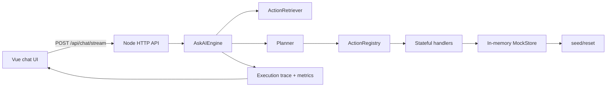
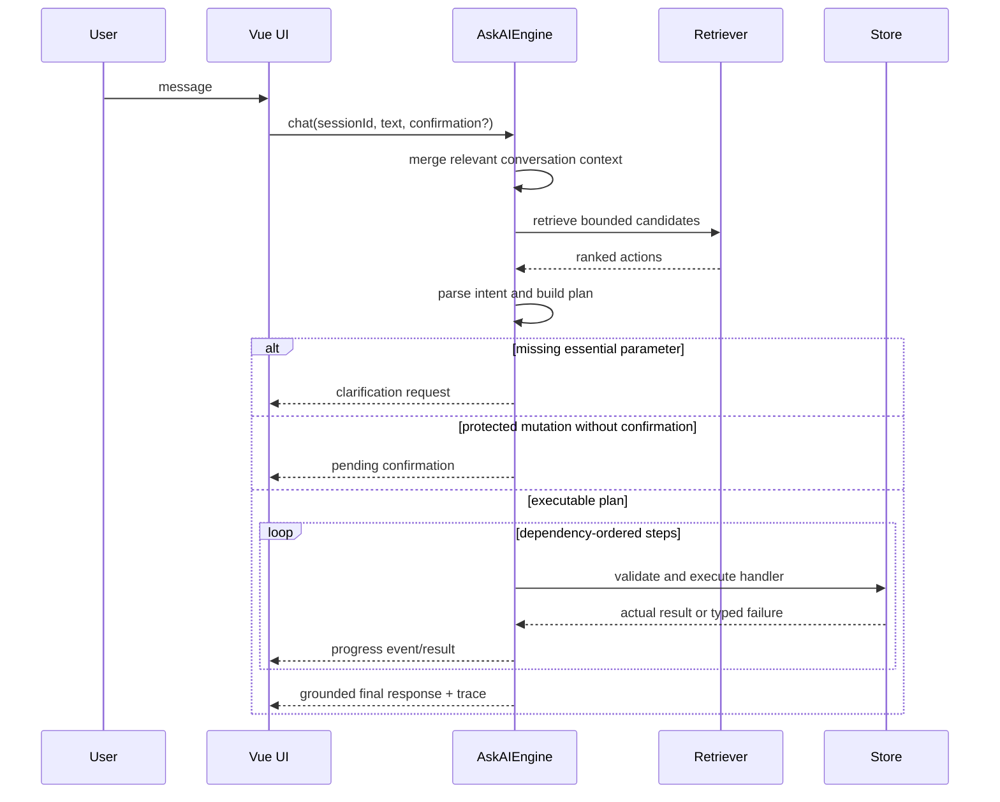

# HighLevel Ask AI architecture

## Scope and source of truth

This repository implements the synthetic Ask AI assignment described by `problem_statement/HighLevel Hiring Assignment Ask AI Framework.pdf` and `problem_statement/ask-ai-50-modules-500-actions.pdf`. The catalog is intentionally a simulated business platform: no real HighLevel API or external side effect is used.

The assignment requires 50 registered modules, exactly 10 meaningful actions per module, a stateful mock store, a Vue chat UI, multi-turn workflows, confirmation for protected operations, an LLM provider and agent orchestration approach, and reproducible evaluation across at least 100 scenarios.

## System overview

The backend uses Node's built-in HTTP server, a provider-backed structured planner, and an explicit LangGraph orchestration boundary. A dependency-light offline path remains available for reproducible local regression. TypeScript types are checked at build time; the frontend uses Vue 3 and Vite.

### Component responsibilities

- `backend/src/catalog.ts` is the single catalog declaration. It contains the exact module/action names from the supplied catalog and derives stable IDs (`M01.A01` through `M50.A10`).
- `backend/src/registry.ts` validates definitions, exposes searchable metadata, and binds every action to a handler. Generic handlers provide consistent CRUD/search behavior while transition and relationship rules add domain semantics.
- `backend/src/store.ts` owns synthetic records, deterministic IDs, seed/reset, relationships, and mutation history. Handlers never mutate UI state directly.
- `backend/src/retrieval.ts` ranks bounded module-aware candidates. The complete catalog is not sent to a model. A hybrid semantic index is a measured follow-up, not an unverified assumption.
- `backend/src/provider.ts`, `backend/src/planner.ts`, `backend/src/plan.ts`, and `backend/src/agent_graph.ts` define the provider-backed structured planning boundary. Provider output is untrusted input: the plan schema, candidate allowlist, dependencies, and action registry validate it before execution. LangGraph coordinates planner state transitions only; it has no store access.
- `backend/src/engine.ts` coordinates context, retrieval, provider-backed planning when configured, an explicitly labeled offline fallback, confirmation, execution, and grounded traces.
- `backend/src/server.ts` exposes `/api/chat`, `/api/chat/stream`, `/api/catalog`, `/api/reset`, and `/api/health`, and serves the built Vue app.
- `frontend/src/App.vue` renders conversation turns, progress, confirmations, failures, partial completion, and action summaries.
- `evaluation/` contains reproducible scenarios and the benchmark runner. Metrics are measured from actual engine/store behavior.

## Request lifecycle

## Catalog, retrieval, and planning

Each action has a stable ID, module, action name, normalized description, operation kind, input schema, output schema, confirmation policy, and handler. Retrieval tokenizes the user message, action name, module name, and descriptions; module matches, exact phrases, and distinctive terms receive higher scores. In provider mode, the top candidates are passed to the structured planner graph. In offline mode, the deterministic parser is used for local regression only.

The current offline baseline scans all 500 definitions with the same lexical scorer and the offline optimized path uses module-aware candidate bounds. These are application regression paths. The provider-backed benchmark will separately compare a full-catalog tool-use baseline with bounded retrieval plus structured Plan DSL planning. Deterministic application code remains authoritative for validation, state transitions, and metrics.

Complex examples are represented as plans with explicit dependencies. A plan step can fan out over a prior result and exclude records from another result by a declared relationship field. The follow-up workflow searches leads, searches appointments, excludes leads whose `contactId` is booked, and creates one task per remaining lead. The invoice workflow applies the same dataflow to `customerId` and recent reminder records. Outputs are stored in a step context and are consumed by subsequent steps.

## State and domain behavior

The mock store seeds representative records for every module, including contacts, leads, appointments, invoices, messages, users, and teams. Other modules receive valid synthetic records with module-specific common fields. IDs are deterministic after reset. Reads reflect mutations immediately; reset restores the same snapshot.

The handler layer distinguishes:

- reads/searches, which return matching records;
- creates/updates, which validate and persist fields;
- state transitions, which enforce allowed status changes;
- relationships, which update both sides where applicable;
- protected operations, which require confirmation before execution;
- unsupported or invalid requests, which return typed errors rather than fabricated success.

The store records an execution history and mutation audit entries. Key relationships validate referenced IDs and update both sides. The API returns trace steps with `success`, `failed`, `pending_confirmation`, or `skipped` status, and the final response is built only from those results.

## Confirmation, retries, and partial failure

Archive, delete, revoke, remove, cancel, publish/send, financial, fan-out/bulk, and externally visible operations are protected according to action metadata. Confirmation is a server-side policy, not a UI-only convention: the API returns a read-first preview, estimated mutation count, sample IDs, a plan hash, and a one-time token. The UI supports explicit confirm and cancel actions. Idempotent reads/searches retry at most once after a transient tool failure; non-idempotent mutations are never blindly retried. Client-supplied idempotency keys prevent replaying the same mutation. If provider planning fails, safe read-only fallback may continue, but state-changing fallback plans fail closed with no mutation. A workflow stops dependent steps after a failure and marks them skipped, while independent steps may continue. No model-style prose can override a failed handler.

## Observability and evaluation

Every request receives a trace ID, timestamps, chosen actions, validation results, step outputs, retries, token usage, provider metadata, cost, and duration. `/api/chat/stream` emits completed step traces as server-sent events so the UI can show useful progress. First-useful timing is measured at the first completed trace step or confirmation preview; loading indicators do not count. Provider errors are returned as diagnostics without exposing credentials. Offline token/cost values are estimates and are labeled deterministic; provider values are recorded from the API response. The evaluator records action-selection accuracy, required-parameter accuracy, final-state correctness, end-to-end success, p50/p95 latency, model-call count, token/cost data, and failure categories. Unavailable external-provider metrics remain `NOT_MEASURED`.

## Extension strategy

To add a module, add one entry with exactly ten actions to `catalog.ts`, provide any specialized rules in `registry.ts`, and add scenarios. Core retrieval, validation, execution, tracing, UI rendering, and evaluation do not need rewriting. A future persistent store can implement the `StorePort` shape without changing handlers.

## Assumptions, risks, and alternatives

- Assumption: synthetic state is sufficient because the assignment explicitly excludes real integrations.
- Assumption: offline mode is required for reproducible development, but it is not a substitute for the provider-backed AI path required by the assignment.
- Risk: lexical retrieval is weaker than embeddings for novel paraphrases. BM25/metadata retrieval is the first measured baseline; semantic retrieval is added only if dev-set misses justify its cost and operational complexity.
- Risk: the mock domain is broad. Generic handlers are used only for common operations; transitions and relationships have explicit rules.
- Alternative rejected: shipping a single fake-success handler. It would violate state mutation, validation, and final-state requirements.

## Target production architecture

The live AI path is intentionally separate from the offline path:

request
  -> structured working memory
  -> bounded retrieval (top 15-25 action cards)
  -> LLM router/planner
  -> Zod Plan DSL validation and candidate allowlist
  -> deterministic DAG executor
  -> read-first safety/confirmation gate
  -> typed registry handlers
  -> execution ledger and actual state verification
  -> grounded response and SSE trace

The LLM may interpret intent, resolve a plan, and draft wording. It may not bypass action schemas, confirmation policy, referential integrity, idempotency, or the store. The current provider adapter now supports structured plan generation; the offline deterministic planner remains available for no-credential development and regression tests and is labeled as such.

### Production milestones

1. Structured planner: provider-backed Plan DSL, runtime validation, candidate allowlist, LangGraph planner graph, and fake-provider contract tests. **Implemented; OpenCode Go smoke-verified with transient timeout variability documented.**
2. Generic execution DSL: filter, exclude, join, count, sort, limit, foreach, date resolution, entity resolution, and plan-hash confirmation are implemented; parallel execution and durable ledgers remain next.
3. Safety and domain hardening: explicit risk metadata, read-first previews, plan-hash confirmation, relative date/entity resolution, and durable StorePort adapter. **In progress; core preview/hash/date/entity pieces implemented.**
4. Evaluation: realistic natural-language scenarios, provider-backed baseline versus optimized runs, real token/cost accounting, and dev/test split. **Implemented: live 102-scenario dual-track benchmark completed with real token accounting and 94.6% input-token savings documented in EVALUATION.md; USD pricing remains unconfigured.**
5. Product hardening: plan cards, confirmation previews, result tables, trace drawer, and deployment-oriented API lifecycle. **Planned.**

Hybrid embeddings and SQLite are implementation options, not acceptance criteria by themselves. The graph framework is now used for planner state transitions because the assignment calls for agent orchestration; it must remain outside domain mutation code. Each further infrastructure change must improve measured recall, reliability, operability, or cost.
