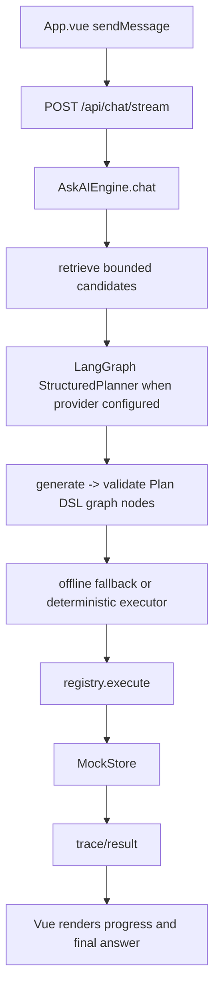

# Code flow guide

This document is kept aligned with the implementation. The main path is:

## Startup

`backend/src/server.ts` creates a store, builds the validated registry, constructs the engine, and starts the Node HTTP server. `frontend/src/main.ts` mounts `App.vue`; Vite serves the UI during development and the backend serves `frontend/dist` in production.

## Chat request

`App.vue` sends a session ID, message, and idempotency key to `/api/chat/stream`. The server parses JSON and calls `AskAIEngine.chat` with a progress callback. The engine builds structured working memory, normalizes safe input noise, retrieves bounded candidates, and asks the configured provider for a structured Plan DSL document. `plan.ts` validates the document, candidate allowlist, dependencies, and dataflow references before execution. If no provider is configured, the explicitly labeled offline planner is used for reproducible development. The server emits each completed trace step as an SSE progress event and then emits the grounded final response.

The planner creates `PlanStep` objects with action IDs, validated parameters, dependency IDs, and optional `forEachFrom`/`excludeBy` relationship fields. The executor walks steps in dependency order. A fan-out step resolves prior outputs, filters excluded records, and invokes the action once per eligible record. Each invocation calls `registry.execute`, which validates the action and delegates to a handler from `registry.ts`; handlers call store methods and return the persisted result. Safe reads retry once; mutations do not retry blindly. The engine records duration, retries, output summary, and status. Dependent steps are skipped after a failure; independent steps may still run.

## State and follow-ups

`MockStore.reset()` creates the same seed snapshot each time. Mutating handlers call store mutation methods; later searches and gets observe those changes. Relationship handlers validate referenced records and update both sides where supported. The session context stores selected IDs, filters, and the prior plan. A follow-up such as “make those tasks due tomorrow” resolves “those tasks” from that context and applies a new due date without asking the user to repeat the original filter.

## Safety and errors

Confirmation policy is read from the action definition. The engine returns `needs_confirmation` with a read-first preview, plan hash, and one-time token before protected execution. The user can explicitly confirm or cancel; cancellation consumes the pending plan and performs no mutation. A confirmed request consumes the token and executes exactly once. Validation errors, missing records, invalid transitions, provider failures, and simulated tool failures are serialized as explicit diagnostics or step failures. Provider fallback is allowed for safe reads but fails closed for state-changing plans. Final text is generated from the trace, so a failed handler cannot be reported as success.

## Evaluation flow

The evaluator resets the store before each scenario, sends the scenario messages through the same engine used by the API, and asserts both trace/action behavior and final store state. It then runs each of the 500 definitions with generated valid inputs. Baseline and optimized retrieval use the same scenarios and report first-useful timing at the first completed trace or confirmation preview, completion latency, action/parameter/final-state accuracy, retries, provider errors, and estimated cost.

## Concrete flows

### Direct contact creation

`App.vue -> server.ts -> AskAIEngine.chat -> retrieveActions` selects `M01.A01 Create contact`. The parser extracts a name/email, `registry.execute` validates them, and the Contacts handler calls `store.create`. The returned contact ID is included in the response and can be fetched immediately with `M01.A02`.

### Multi-step follow-up workflow

The planner creates a lead search step, an appointment exclusion step, and a task creation step. Search output is placed in step context; the filter removes contacts with booked appointments; task creation receives the remaining contact IDs. The trace shows each dependency and the final task records.

### Protected invoice reminder

A reminder/send action is planned but held at `pending_confirmation`. The UI renders a confirmation control. After confirmation, the handler records the simulated outbound message; the response labels it simulated and returns the actual message ID.

### Provider-backed planning

When an API key is configured, retrieval produces a bounded candidate set and `StructuredPlanner` invokes `AgentPlanGraph`. The graph has explicit `generate` and `validate` nodes and ends with a validated JSON Plan DSL document. The provider never receives the full store and cannot invent action IDs outside the candidate set. `validatePlanDocument` rejects malformed plans, unknown actions, unresolved dependencies, and invalid references. A validation or provider failure is recorded as a provider fallback and uses the offline planner so local development remains reproducible. The graph has no store port; only the deterministic executor can mutate state.
